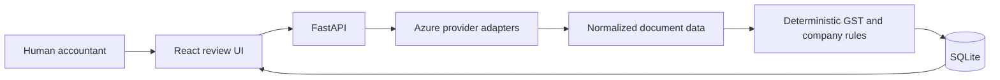

# GST Invoice Requirements Reviewer architecture

GST Invoice Requirements Reviewer is a small local full-stack application. Azure Document Intelligence extracts invoice evidence and is the document-type gate; Azure OpenAI is called only when core GST fields or the entire GST tax breakup are missing; deterministic Python rules identify missing applicable GST particulars and visible local inconsistencies; a person interprets the result.

## Intended boundaries

- Provider adapters normalize Azure responses before data reaches the domain.
- Deterministic GST invoice rules remain separate from model extraction.
- Routes own HTTP concerns, a service owns orchestration, and a repository owns SQLite access.
- Environment values are read through one backend settings module and one frontend environment module.
- A person compares the result with the source document and decides any follow-up outside the app.

## Target flow

## Starter checkpoint

The backend exposes `GET /health`, the frontend renders the starter screen, the fictional corpus is available under `samples/`, and no completed review workflow exists on `main`.
